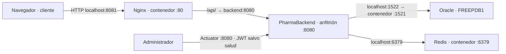

# PharmaBackend — PharmaSoft

API REST con Spring Boot 4.0.7 y Java 25. Utiliza Oracle como base de negocio, Flyway
para migraciones, JWT para autenticación/autorización, Redis para caché y Actuator
para salud y métricas. El frontend se mantiene en el repositorio PharmaFrontend.

## Desarrollo y pruebas

El perfil predeterminado es dev, destinado al laboratorio. No usar sus credenciales
ni clave JWT de demostración como secretos de producción. La configuración prod exige
variables externas. Oracle debe estar disponible para arrancar la aplicación real.

```text
./mvnw.cmd test
./mvnw.cmd package -DskipTests
```

Las pruebas de integración que requieren Oracle/Redis reales son opt-in; no se deben
presentar como ejecutadas si están omitidas. Las pruebas aisladas usan H2 donde corresponde.

## Despliegue en producción

### Arquitectura y puertos



Esta es la topología LOCAL actual. `backend:host-gateway` permite a Nginx alcanzar Java
fuera de Docker. Compose del frontend administra solo Nginx y Redis; Oracle es un
contenedor independiente. La aplicación web se publica en `127.0.0.1:8081`, Redis en
`127.0.0.1:6379` y Oracle usa `1522` en el anfitrión. El navegador no accede directamente
a Oracle ni Redis. El API de la SPA usa `/api/v1` por el mismo origen.

No es un despliegue remoto listo para tres sucursales: requiere dominio, HTTPS y red
privada/controlada entre servicios. Los puertos internos de Oracle/Redis no deben
publicarse a Internet. Actuator se consulta directamente al backend; Nginx no lo expone.

### Variables de entorno

| Variable del proceso Java | Propósito | Requerimiento |
|---|---|---|
| `SPRING_PROFILES_ACTIVE` | Seleccionar configuración | `prod`; el valor predeterminado del proyecto es dev. |
| `SERVER_PORT` | Puerto HTTP del backend | 8080 por defecto; mantenerlo alineado con Nginx. |
| `DB_URL` | URL JDBC de Oracle | Obligatoria en prod; usar el servicio y puerto del entorno. |
| `DB_USERNAME` | Cuenta de la aplicación en Oracle | Obligatoria; cuenta dedicada con privilegios mínimos. |
| `DB_PASSWORD` | Contraseña de esa cuenta | Obligatoria, secreta y externa a Git. |
| `JWT_SECRET` | Clave de firma JWT | Base64 de al menos 32 bytes aleatorios; nueva para prod. |
| `JWT_EXPIRACION_MINUTOS` | Vigencia del token | Opcional; 30 minutos por defecto en prod. |
| `CORS_ALLOWED_ORIGINS` | Orígenes autorizados si hay acceso cruzado | Obligatoria en prod; origen con esquema/host/puerto, sin ruta. Para el laboratorio: http://localhost:8081. |
| `REDIS_HOST` | Servidor de caché | localhost por defecto para Java en el anfitrión. |
| `REDIS_PORT` | Puerto Redis | 6379 por defecto. |

No guardar valores reales de credenciales en ejemplos, capturas ni archivos versionados.
Inyectarlos al proceso Java desde su configuración local o gestor de secretos. Un `.env`
de Docker Compose **no configura automáticamente** Java ejecutado en el anfitrión y
Spring no carga un archivo `.env` por sí solo. Si se conserva uno, debe permanecer fuera
de Git y el mecanismo de arranque debe transmitir sus valores. La SPA no recibe secretos.
El nombre consumido es `CORS_ALLOWED_ORIGINS`, no `FRONTEND_ORIGINS`.

### Construir y desplegar

1. Registrar el commit/release a desplegar. Antes de reemplazar la versión existente,
   guardar el JAR correcto anterior fuera del repositorio y una referencia de su
   configuración; las credenciales deben permanecer en el gestor/configuración local.
2. Disponer de Oracle y una copia de seguridad recuperable. Flyway contiene
   V1__esquema_ventas y V2__seguridad. Revisar el estado de migraciones antes del arranque;
   no editar migraciones ya aplicadas ni ejecutar clean contra la base de negocio.
3. Desde el frontend, compilar primero su SPA si es necesario y arrancar Compose para
   Redis/Nginx según su README. Oracle permanece en su contenedor independiente.
4. Desde la raíz backend, construir:

   ```text
   ./mvnw.cmd package -DskipTests
   ```

   Este comando empaqueta; no significa que las pruebas se hayan ejecutado.
5. Configurar las variables anteriores en el IDE o servicio Java. Detener la instancia
   previa que usa 8080 y arrancar el JAR desde la raíz backend:

   ```text
   java -jar target/PharmaBackend-0.0.1-SNAPSHOT.jar
   ```

6. Confirmar perfil prod y finalización del arranque. Consultar /actuator/health por
   localhost:8080; salud no requiere token, detalles requieren admin. Las métricas
   requieren USUARIOS_ADMINISTRAR. El archivo se escribe en logs/pharma-backend.log
   relativo al directorio de trabajo; si se usa un servicio, fijar ese directorio.
7. La SPA usa Nginx en 8081 y /api/v1; CORS_ALLOWED_ORIGINS debe concordar con los
   orígenes de acceso directo previstos. Una respuesta 502 de Nginx requiere revisar
   conectividad/arranque del backend, no asumir un problema CORS.

Prod deshabilita Swagger y api-docs, SQL y bindings de parámetros. La política de
rotación es 10 MB por archivo y 14 períodos de historial. Las claves y passwords
siguen fuera del archivo de log; auditar su contenido en la Parte D.

### Volver a la versión anterior

1. Conservar el log del fallo y detener únicamente el proceso Java de esa versión.
2. Restaurar el JAR anterior guardado fuera de target (Maven clean elimina target).
   Usar su configuración compatible y el directorio de trabajo conocido; no hace
   falta reconstruir el commit anterior ni borrar cambios locales.
3. Verificar primero que el esquema Oracle sigue siendo compatible con el JAR anterior.
   No hay nuevas migraciones en estos cambios S13. Si una versión futura migra el esquema
   de forma incompatible, Flyway no revierte automáticamente: aplicar el plan de base
   de datos previamente probado o restaurar un respaldo con aprobación operativa.
4. Reiniciar y consultar salud. Redis no es la base de negocio. Si el formato de DTO
   cacheado cambió entre versiones, invalidar solo los espacios categorias/productos
   o usar un namespace versionado antes de recuperar tráfico; no ejecutar FLUSHALL
   contra un Redis compartido. En el Redis local dedicado, recrear su contenedor
   descarta su caché efímera; no confundirlo con Oracle ni hacerlo sobre otros servicios.
5. Coordinar la versión de SPA compatible. Conservar la clave JWT cuando proceda;
   si hubo rotación por seguridad, exigir nuevo login en lugar de restaurar una clave comprometida.

### Estado de buenas prácticas

| Práctica | Estado del código/configuración | Acción pendiente o alcance |
|---|---|---|
| Features y layout privados lazy; reporte con @defer | Cumple | Conservar mediciones de bundle y navegación. |
| Precarga justificada con cifras | Cumple parcialmente | Variantes preparadas; medir y decidir antes del informe. |
| Entornos, hashes y budgets | Cumple | Build normal de producción; API relativa. |
| HTML revalidado, JS/CSS con hash immutable, fallback y proxy | Cumple | Registrar cabeceras y actualización de versión en Parte B. |
| API sin almacenamiento en navegador | Cumple | Spring Security aplica su política; comprobar la respuesta real. |
| Redis TTL, estadísticas e invalidación de escrituras | Cumple parcialmente | Anotaciones y pruebas técnicas presentes; ejecutar las mediciones y matriz C. |
| Lecturas con Redis caído | Cumple parcialmente | Fallback presente; si hubo escrituras durante una caída, no se garantiza invalidación diferida al recuperar Redis. |
| Logs con requestId y código en errores | Cumple | Implementados en backend y SPA; tomar evidencia manual D. |
| Log de prod rotado y SQL desactivado | Cumple | Archivo de 10 MB por rotación y 14 períodos de historial configurados; auditar su contenido. |
| Salud pública mínima y métricas administrativas | Cumple | Ejecutar las combinaciones de salud requeridas y conservar evidencia. |
| Secretos externos y datos personales fuera del log | Cumple parcialmente | Prod exige variables; demo dev tiene credenciales públicas. Auditar archivos reales, DNI y tokens; no usar claves demo en prod. |
| HTTPS | No cumple | Configurar certificado, redirección y acceso seguro antes del uso entre locales. |
| Redis autenticado/cifrado y alta disponibilidad | No cumple | Configuración local sin ACL/TLS ni alta disponibilidad; proteger red y definir recuperación. |
| Copias de seguridad verificadas de Oracle | No cumple | No hay automatización incluida; programar y ensayar restauración. |
| Despliegue atómico y rollback automatizado | Cumple parcialmente | Procedimiento manual documentado; el montaje actual no garantiza intercambio atómico. |
| Alertas operativas y continuidad de red entre locales | No cumple | Integrar monitoreo externo y plan de contingencia. |

Los estados describen la implementación disponible; no convierten mediciones o capturas
pendientes en verificaciones aprobadas. Redis es caché descartable: Oracle conserva los
datos de negocio. La configuración actual de Redis no incorpora un volumen persistente.

### Tres recomendaciones para los locales

1. **Prioridad alta — acceso seguro y coherente para los tres locales.** Centralizar
   el API y la base de negocio, exponer la SPA mediante un dominio HTTPS y usar red
   privada/VPN y controles de acceso para los servicios internos. Redis compartido por
   las instancias del backend evita catálogos independientes, pero necesita ACL/TLS,
   supervisión y una estrategia de disponibilidad; no publicar su puerto a los locales.
2. **Prioridad alta — recuperación de datos.** Automatizar copias de Oracle con retención
   y copia externa, definir objetivos RPO/RTO y ensayar la restauración. Guardar además
   artefactos de cada versión y sus configuraciones sin secretos para rollback.
3. **Prioridad media — operación observable y continuidad.** Alertar sobre health DOWN,
   errores y latencias de ventas; supervisar capacidad/disco y Redis desde una red
   administrativa. Usar requestId para soporte y definir qué hará cada local si pierde
   conexión. No se promete venta offline: esa capacidad no existe en esta versión.

## Validación y documentación S13 autónoma

- Etapa 2: docs/s13-autonoma/etapa-02.md — requestId en errores.
- Etapa 4: docs/s13-autonoma/etapa-04.md — mediciones, invalidación y monitoreo.
- Colección: postman/PharmaSoft-S13-Autonoma.postman_collection.json.
- Entrega final prevista: docs/informe-s13.pdf, creada después de revisar las evidencias.
